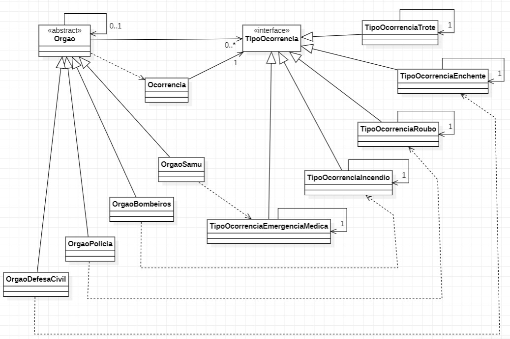

# Exercício Chain of Responsability, Cadeia de Emergências
#### Nome: João Vitor Fernandes Ribeiro Carneiro Ramos
#### Matrícula: 202165076C

Implementação do padrão de projeto **Chain of Responsability** em Java.

## Diagrama UML

